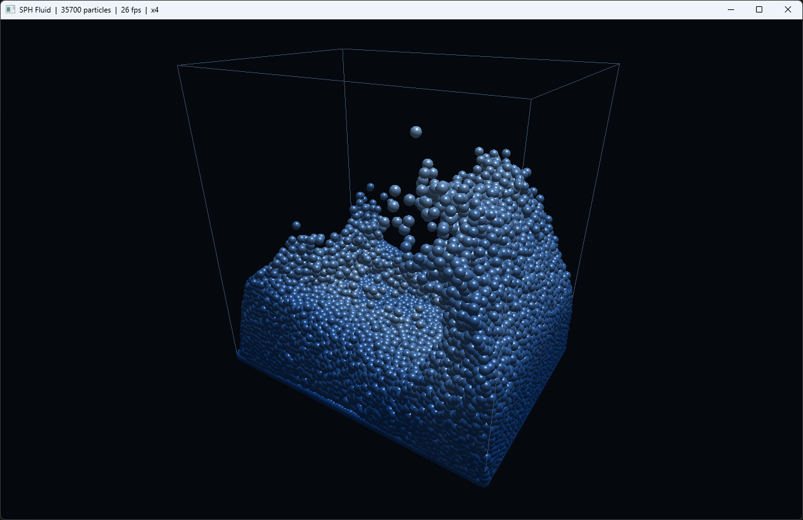

# SPH Fluid

[](https://github.com/sponsors/makarov-mm)
[](LICENSE)


[](https://www.linkedin.com/in/makarov-mm/)
[](https://www.threads.net/@m.m.makarov)
[](https://www.instagram.com/m.m.makarov/)

A 3D water simulator written from scratch in C++. The water is thousands of
particles pulling on each other; there's no game engine and no physics library
doing the work, and no third-party code at all: the viewer talks to Win32 and
OpenGL directly.

I wrote it to understand how fluids are actually simulated, instead of wrapping
someone else's solver.



## How it works

The fluid is a cloud of particles. Each one carries mass and velocity, and the
smooth, continuous quantities of real water — density, pressure, the forces
between blobs of fluid — are rebuilt by summing smooth kernels over nearby
particles. That's the whole idea behind SPH (Smoothed Particle Hydrodynamics).

The parts that actually matter for getting water that behaves:

- **Density** comes from the poly6 kernel.
- **Pressure** uses a stiff Tait equation of state, `p ∝ (ρ/ρ₀)⁷ − 1`. The steep
  exponent is what stops the water from squashing: density stays within a few
  percent of rest instead of collapsing.
- **Stability** comes from Monaghan artificial viscosity, which bleeds off energy
  when particles rush together. Without it, a dropped column of water doesn't
  settle, it detonates.
- **Neighbours** are found with a uniform grid (cell size = the smoothing radius,
  built with a counting sort), so each step costs O(N) instead of O(N²). The
  particles are re-sorted by cell every step, so neighbours also sit next to each
  other in memory.
- **Time stepping** is semi-implicit Euler with a fixed step that stays inside the
  CFL limit for the chosen sound speed.

There's also a thin repulsive cushion at the tank walls. Particles next to a wall
are missing the neighbours that would sit on the other side of it, so their
density reads low and the wall never pushes back. Left alone, sloshing water
climbs the walls and sticks there. The cushion (plus a little drag in the
boundary layer) fixes it.

Every pass runs on a small persistent thread pool, so the work spreads over all
cores without creating threads every step.

## Rendering

The water surface is reconstructed on the CPU. Every particle adds a smooth
kernel to a scalar field on a regular grid (particles near the walls and the floor
are mirrored, so the surface meets them at the right height), a light blur
removes the terracing of the coarse grid, and the boundary of the water is
triangulated with marching tetrahedra: each grid cube is split into six
tetrahedra, which needs no 256-case lookup table and has no ambiguous cases. The
grid is aligned with the tank, and the water is clipped to the glass and the
floor, so the body is closed with flat faces where it touches them. The mesh is
rebuilt whenever the simulation advances.

The water shader blends a procedural sky reflection over a depth-tinted body with
a Fresnel term and adds a sharp sun glint. Fast particles in a sparse
neighbourhood are drawn as foam and spray. `M` switches to the raw particles,
drawn as lit spheres that go from blue to white with speed.

`O` restarts the dam break with a solid sphere in the way. It is a collider in the
solver, not a rendering trick: particles that end up inside are projected back to
its surface, their normal velocity is reflected with damping and the tangential
one is cut by friction. Cheap and stable, but only approximate right at the
sphere.

The HUD (`H`) shows FPS, particle count, simulation speed, the active mode and the
controls; the window title carries a compact version of the same.

Knobs: surface quality in `SurfaceSettings` (`src/surface.hpp`), solver
parameters in `SphParams` (`src/sph.hpp`), the scenario in `src/scene.cpp`.

## Build

Windows 10 or later and Visual Studio 2026 with the *Desktop development with C++*
workload.

Open `SphFluidViewer.slnx`, set the configuration to **Release | x64**, and run
(`Ctrl+F5`). There are no external dependencies: the project links only
`opengl32`, `gdi32` and `user32` from the Windows SDK and loads the OpenGL 3.3
functions it needs at runtime. It needs a GPU driver with OpenGL 3.3; over Remote
Desktop or on the basic display driver there isn't one, and the program says so.

## Controls

| Input        | Action                                         |
|--------------|------------------------------------------------|
| left-drag    | orbit the camera                               |
| mouse wheel  | zoom                                           |
| `Space`      | pause / resume                                 |
| `↑` / `↓`    | simulation speed (substeps per frame)          |
| `R`          | restart the dam break                          |
| `M`          | reconstructed surface / particles              |
| `P`          | particle overlay in surface mode               |
| `F`          | foam and spray in surface mode                 |
| `O`          | sphere obstacle on / off (restarts the scene)  |
| `H`          | HUD on / off                                   |
| `Esc`        | quit                                           |

## Layout

```
src/vec3.hpp, mat4.hpp          3D vector, 4x4 matrix, orbit camera
src/thread_pool.hpp/.cpp        persistent fork-join pool for the parallel loops
src/kernels.hpp                 SPH smoothing kernels
src/grid.hpp                    uniform neighbour grid (counting sort)
src/sph.hpp/.cpp                the solver: density, pressure, forces, integration, collisions
src/scene.hpp/.cpp              the dam-break scenario and the tank wireframe
src/surface.hpp/.cpp            surface reconstruction (scalar field + marching tetrahedra)
src/gl.hpp, gl_win32.cpp        OpenGL 3.3 entry points and their WGL loader
src/shaders.hpp                 GLSL sources
src/renderer.hpp/.cpp           sky, tank, water, foam, particles, HUD
src/win32.hpp, main_win32.cpp   window, input, OpenGL context, main loop
```

Only `win32.hpp`, `main_win32.cpp` and `gl_win32.cpp` are Windows-specific; the
solver, the surface reconstruction and the renderer are plain C++ and OpenGL.

## License

MIT, see [LICENSE](LICENSE).

## Support

If you found this project interesting or useful, you can support my work:

[](https://github.com/sponsors/makarov-mm)
